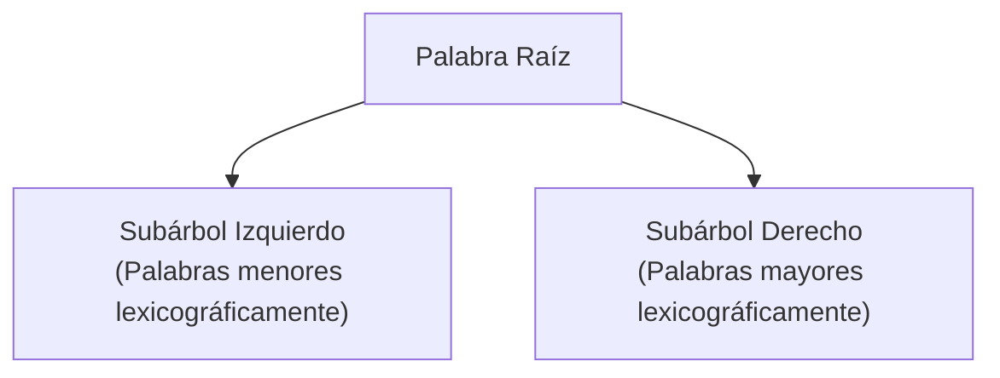
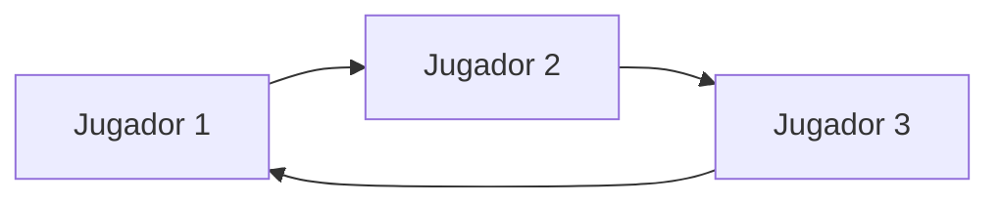

# 🎮 Adivina y Aprende - Juego del Ahorcado en Java

[](https://www.java.com/)
[](https://docs.oracle.com/javase/8/docs/technotes/guides/swing/)
[](#-estructuras-de-datos-implementadas)
[](#-licencia)

> Aplicación interactiva de escritorio desarrollada en Java que reinventa el clásico juego del ahorcado, incorporando **estructuras de datos no lineales y lineales implementadas desde cero**, soporte multijugador por rondas, selección de dificultades y modalidades de juego por tiempo o por intentos.

---

## 📌 Tabla de Contenidos

1. [Descripción General](#-descripción-general)
2. [Estructuras de Datos Implementadas](#-estructuras-de-datos-implementadas)
3. [Características Principales](#-características-principales)
4. [Modalidades y Dificultades](#-modalidades-y-dificultades)
5. [Arquitectura del Proyecto](#-arquitectura-del-proyecto)
6. [Requisitos del Sistema](#-requisitos-del-sistema)
7. [Instalación y Ejecución](#-instalación-y-ejecución)
8. [Formato de Carga de Palabras](#-formato-de-carga-de-palabras)
9. [Autor](#-autor)
10. [Licencia](#-licencia)

---

## 📖 Descripción General

**Adivina y Aprende** es un juego educativo y de destreza mental creado para ejercitar el vocabulario mediante la deducción de palabras ocultas con comodines. 

A diferencia de implementaciones convencionales del ahorcado, este proyecto fue diseñado poniendo énfasis en los **fundamentos de la ciencia de la computación**, abstrayendo el manejo de datos en estructuras de memoria dinámicas propias:
- Un **Árbol Binario de Búsqueda (BST)** lexicográfico para la organización e inserción eficiente del catálogo de palabras.
- Una **Lista Enlazada Circular** genérica para la rotación fluida y equitativa de turnos entre múltiples jugadores.

Cuenta con una **interfaz gráfica (GUI)** construida con **Java Swing**, facilitando la interacción mediante paneles intuitivos, temporizadores en tiempo real y cuadros de diálogo interactivos.

---

## 🧠 Estructuras de Datos Implementadas

Uno de los mayores atractivos técnicos del proyecto es la implementación manual (sin librerías externas de colecciones) de las siguientes estructuras:

### 1. Árbol Binario de Búsqueda de Palabras (`ArbolPalabras` & `NodoArbol`)
* **Propósito:** Almacenar el diccionario de palabras y sus comodines en orden alfabético.
* **Operaciones implementadas:**
  * `insertar(Palabra)`: Inserción recursiva basada en comparación lexicográfica (`compareTo`).
  * `buscar(String)`: Búsqueda binaria recursiva eficiente con complejidad promedio $\mathcal{O}(\log n)$.
  * `obtenerTodasLasPalabras()`: Recorrido **In-Order** (inorden) que devuelve las palabras ordenadas alfabéticamente.



### 2. Lista Enlazada Circular (`ListaCircular<T>` & `NodoCircular<T>`)
* **Propósito:** Gestionar la ronda y turnos de los jugadores de forma cíclica e indefinida.
* **Diseño Genérico:** Soporta cualquier tipo de dato mediante `T` (utilizado para objetos `Jugador`).
* **Operaciones implementadas:**
  * `insertar(T dato)`: Inserta un nodo al final y enlaza el último elemento directamente a la cabeza (`primero`).
  * `avanzar()`: Traslada el puntero `actual` al nodo consecuente en ciclo continuo.
  * `obtenerActual()`: Recupera el jugador en turno sin romper el ciclo.
  * `getTotal()`: Calcula el número total de nodos en la lista.



---

## ✨ Características Principales

- 👥 **Soporte Multijugador:** Registro dinámico de 1 a $N$ jugadores, con opción de listar y eliminar participantes antes de iniciar.
- 🎯 **Sistema de Puntuación Justo:**
  - `+1.0 punto` por acertar la palabra en el primer intento.
  - `+0.5 puntos` por acertar en intentos posteriores.
- ⏱️ **Temporizador Integrado:** Cronómetro regresivo por turno utilizando `java.util.Timer` y `TimerTask`.
- 📁 **Persistencia y Gestión de Datos:**
  - Carga masiva de palabras desde archivos `.txt`.
  - Inserción manual de nuevas palabras en caliente desde la interfaz.
  - Vaciado y limpieza de listas de palabras por dificultad.
- 🖥️ **Diseño GUI Intuitivo:** Ventanas de diálogo (`JOptionPane`), campos interactivos, áreas de registro de turnos y actualización de estado.

---

## 🕹️ Modalidades y Dificultades

### Modalidades de Juego
1. **Por Tiempo:** El jugador debe adivinar la palabra antes de que el reloj llegue a cero.
2. **Por Intentos:** Se define una cantidad máxima de fallos permitidos antes de perder el turno.

### Niveles de Dificultad
El juego divide el vocabulario en 4 categorías configurables:
* 🟢 **Fácil:** Palabras cortas o con pocos comodines ocultos.
* 🟡 **Normal:** Palabras de longitud intermedia con retos moderados.
* 🔴 **Difícil:** Palabras complejas, técnicas o con múltiples comodines.
* 🎲 **Aleatorio:** Selección mixta de retos variados.

---

## 📂 Arquitectura del Proyecto

```
Juego-en-Java/
├── Dificultad/                          # Archivos de texto con el banco de palabras
│   ├── Aleatorio.txt
│   ├── Difícil.txt
│   ├── Fácil.txt
│   └── Normal.txt
├── nbproject/                           # Configuración del proyecto Apache NetBeans
│   ├── build-impl.xml
│   ├── genfiles.properties
│   ├── project.properties
│   └── project.xml
├── src/
│   └── ElAhorcadoJuego/                 # Paquete principal del juego
│       ├── ArbolPalabras.java           # Implementación del Árbol Binario de Búsqueda
│       ├── NodoArbol.java               # Nodo para el Árbol Binario
│       ├── ListaCircular.java           # Implementación de Lista Enlazada Circular genérica
│       ├── NodoCircular.java            # Nodo para la Lista Circular
│       ├── Palabra.java                 # Modelo de datos para palabras y comodines
│       ├── Jugador.java                 # Modelo de datos para jugadores y puntajes
│       ├── Juego.java                   # Motor de reglas, turnos, rondas y validaciones
│       ├── MenuGUI.java                 # Interfaz gráfica: Menú principal y administración
│       ├── JuegoAhorcadoGUI.java        # Interfaz gráfica: Pantalla de juego y temporizador
│       └── main.java                    # Punto de entrada de la aplicación
├── .gitignore                           # Exclusión de archivos compilados, temporales y secretos
├── build.xml                            # Script de compilación Apache Ant
├── manifest.mf                          # Manifiesto de la aplicación JAR
└── README.md                            # Documentación del repositorio
```

---

## 💻 Requisitos del Sistema

- **Java Development Kit (JDK):** Versión 8 o superior (compatible con Java 11, 17, 21+).
- **Sistema Operativo:** Windows, Linux o macOS.
- **Entorno de Desarrollo (Opcional):** Apache NetBeans, IntelliJ IDEA, Eclipse o Visual Studio Code.

---

## 🚀 Instalación y Ejecución

### Opción 1: Ejecución desde la Consola (CLI)

1. **Clonar el repositorio:**
   ```bash
   git clone https://github.com/T1Angel4220/Juego-en-Java.git
   cd Juego-en-Java
   ```

2. **Compilar las clases:**
   ```bash
   javac -d bin -encoding UTF-8 src/ElAhorcadoJuego/*.java
   ```

3. **Ejecutar el programa:**
   ```bash
   java -cp bin ElAhorcadoJuego.main
   ```

### Opción 2: Ejecución desde un IDE (Apache NetBeans recomendado)

1. Abre NetBeans y selecciona **File > Open Project**.
2. Navega hasta la carpeta del proyecto y selecciona `Juego-en-Java`.
3. Haz clic derecho sobre el proyecto y selecciona **Clean and Build**.
4. Presiona <kbd>F6</kbd> o haz clic en **Run Project** para iniciar el juego.

---

## 📝 Formato de Carga de Palabras

Los archivos ubicados en la carpeta `Dificultad/` siguen una estructura sencilla basada en tokens separados por espacios:

```text
pal*bra a
li**lula b é
*s*e*noc*e*d*masto*deo e r l i t o i
```

* **Primer token:** La palabra a adivinar, donde cada asterisco (`*`) representa un comodín oculto.
* **Tokens siguientes:** La letra correspondiente a cada uno de los asteriscos en orden de aparición de izquierda a derecha.

---

## 👤 Autor

* **Angel Ayuquina** - [@T1Angel4220](https://github.com/T1Angel4220)
* Estudiante / Desarrollador de Software enfocado en Estructuras de Datos, Algoritmos y Desarrollo Java.

---

## 📄 Licencia

Este proyecto se encuentra bajo la Licencia [MIT](https://opensource.org/licenses/MIT). Puedes utilizarlo, modificarlo y distribuirlo libremente para fines académicos y personales.
